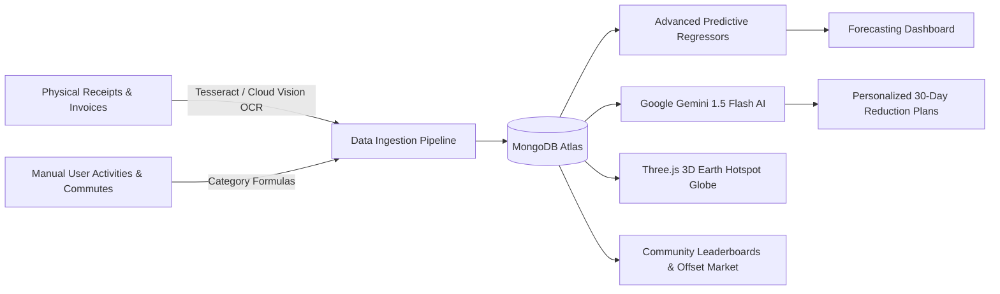

# CarbonIQ 🌱

<p align="center">
  <strong>An Intelligent, Multi-Signal Carbon Footprint Analytics, Predictive Forecasting & Climate Action Platform</strong>
</p>

<p align="center">
  <a href="https://github.com/Madhuarvind/CarbonIQ-"></a>
  
  
  
  
  
  
  
</p>

---

## 📖 Table of Contents

- [Overview](#-overview)
- [Key Features](#-key-features)
- [System Architecture](#-system-architecture)
- [Machine Learning & AI Engine](#-machine-learning--ai-engine)
- [Interactive 3D Visualizations](#-interactive-3d-visualizations)
- [Technology Stack](#-technology-stack)
- [API Endpoints](#-api-endpoints)
- [Directory Structure](#-directory-structure)
- [Getting Started](#-getting-started)
- [Automated Daemon & Scheduled Jobs](#-automated-daemon--scheduled-jobs)
- [Testing & Quality Assurance](#-testing--quality-assurance)
- [Mobile Deployment (Android)](#-mobile-deployment-android)
- [Roadmap](#-roadmap)
- [Contributing & License](#-contributing--license)

---

## 🌍 Overview

**CarbonIQ** (Carbo-Tracker) is an end-to-end climate technology platform that transforms passive environmental awareness into quantifiable, data-driven daily actions. By unifying **optical receipt scanning**, **mathematical predictive forecasting**, **generative AI advisory**, and **interactive 3D geospatial rendering**, CarbonIQ delivers a unified web and mobile experience for tracking and shrinking personal and community carbon footprints.



---

## ⚡ Key Features

### 1. 🧮 Multi-Category Footprint Calculator & Equivalencies
- **Categorical Breakdown:** Tracks emissions across **Transportation** ($km$, flights, transit), **Household Energy** ($kWh$, gas), **Diet & Food** (meat frequencies, food waste), and **Secondary Consumption** (retail, electronics).
- **Relatable Equivalency Translation:** Converts abstract $kg\,CO_2e$ numbers into tangible equivalents:
  - Equivalent mature trees required to sequester the emissions.
  - Miles driven by an average gasoline vehicle.
  - Equivalent smartphone battery charge cycles.

### 2. 🤖 Generative AI Personalized Strategic Plans
- Powered by **Google Gemini 1.5 Flash** (`@google/generative-ai`).
- Generates tailored, 4-week structured reduction plans based on the user's top three emission drivers.
- Every week delivers actionable micro-goals, difficulty ratings (*Easy*, *Medium*, *Hard*), and exact projected $kg\,CO_2e$ savings.

### 3. 📈 Multi-Model Machine Learning Predictions
- **Polynomial Regression (Degree 3):** Solves normal equations $\mathbf{\theta} = (\mathbf{X}^T \mathbf{X})^{-1} \mathbf{X}^T \mathbf{y}$ to identify non-linear behavioral trajectories and evaluate $R^2$ goodness-of-fit.
- **Holt-Winters Exponential Smoothing:** Captures seasonal emission trends and momentum.
- **ARIMA Time-Series Modeling:** Computes autoregressive lag parameters to forecast 30-, 60-, and 90-day targets.
- **Neural Perceptron Simulation:** Simulates cross-category interactions (e.g., weather dips driving heating spikes).

### 4. 🧾 Computer Vision & Receipt Carbon Scanner
- Upload paper receipts, grocery bills, and shopping invoices.
- Image preprocessing through `sharp` (adaptive thresholding, noise removal) and OCR tokenization using **Tesseract.js** and **Google Cloud Vision**.
- Automatic regex classification mapping line items into carbon categories and applying standard emission factors ($kg\,CO_2/\$$).

### 5. 🌐 Interactive 3D WebGL Emissions Globe
- Built using **Three.js** and `@react-three/fiber`.
- Renders an interactive 3D Earth with realistic atmospheric shaders.
- Displays dynamic particle clouds representing global urban emission intensities (New York, Tokyo, London, Delhi, São Paulo, etc.).

### 6. 🌤️ Real-Time Environmental & Air Quality Telemetry
- Direct integration with **OpenWeatherMap Air Pollution API**.
- Live tracking of Air Quality Index (AQI), $PM_{2.5}$, $PM_{10}$, $NO_2$, $SO_2$, and ozone ($O_3$) with situational eco-recommendations.

### 7. 🏆 Gamification, Challenges & Carpooling Hub
- **Badges & Milestones:** Earn recognition for consecutive logging streaks, weekly emission cuts, and verified offsets.
- **Community Challenges:** Team-wide goals for university campuses, organizations, or neighborhoods.
- **Carpool Matcher:** Matches nearby commuters, calculates fuel saved, and estimates collective traffic decongestion.

### 8. 🛒 Offset Marketplace & Eco-Commerce
- Explore certified carbon offset projects (afforestation, wind/solar farms, ocean conservation).
- Sustainable product recommendations featuring eco-certifications and lifecycle impact scores.

---

## 🛠️ Technology Stack

| Layer | Framework / Library | Primary Responsibility |
| :--- | :--- | :--- |
| **Frontend** | Next.js 15.5.3, React 18.3.1 | App Router, Server Components, Client Hydration |
| **Styling** | Tailwind CSS 3.4, Radix UI, Lucide Icons | Responsive modern design, accessible UI components |
| **Data Viz** | Chart.js 4.4, Recharts, Three.js | Line/Radar/Donut analytics and 3D interactive globe |
| **Backend** | Next.js API Route Handlers | Serverless REST endpoints with edge support |
| **Database** | MongoDB Atlas, Mongoose 8.9 | Flexible document persistence with connection pooling |
| **Authentication** | Clerk (`@clerk/nextjs` 6.32) | Session management, OAuth, secure JWT verification |
| **AI / GenAI** | Google Generative AI (Gemini 1.5 Flash) | Contextual 30-day carbon reduction plan generation |
| **OCR / Vision** | Tesseract.js, Google Cloud Vision, Sharp | Receipt ingestion, text extraction, receipt categorization |
| **Mobile Bridge** | Capacitor Android 7.4 (`@capacitor/android`) | Android native compilation and hardware integration |
| **DevOps** | GitHub Actions, Node-Schedule, PM2 | Scheduled jobs, health monitoring, CI/CD pipeline |

---

## 🔌 API Endpoints

| Endpoint | Method | Description |
| :--- | :---: | :--- |
| `/api/emissions` | `GET`, `POST` | Retrieve and record user carbon emissions by category |
| `/api/predictive_analytics` | `POST` | Run Polynomial, Exponential, ARIMA & Neural prediction models |
| `/api/personalized_plan` | `POST` | Generate AI-driven 30-day reduction roadmap with Gemini |
| `/api/computer-vision/receipt-analysis` | `POST` | Upload receipt image buffer for OCR parsing & carbon scoring |
| `/api/environmental_data` | `GET` | Fetch live local weather, AQI, and atmospheric pollution metrics |
| `/api/achievements` | `GET`, `POST` | User milestones, badges, experience points, and ranks |
| `/api/challenges` | `GET`, `POST` | Community challenges, team participation, and leaderboard sync |
| `/api/news` | `GET` | Aggregated and cached climate & sustainability news feed |
| `/api/carbon_offsets` | `GET`, `POST` | Browse and simulate purchases of verified carbon offsets |
| `/api/rides` | `GET`, `POST` | Dynamic carpooling routes, seat bookings, and emissions saved |

---

## 📁 Directory Structure

```
CarbonIQ/
├── android/                         # Capacitor Native Android project
├── e2e/                             # Playwright End-to-End test suites
├── public/                          # Static assets and icons
├── scripts/                         # Automation & maintenance jobs
│   ├── scheduled-jobs.js            # Node-Schedule cron daemon
│   ├── database-cleanup.js          # DB hygiene and log maintenance
│   ├── send-notifications.js        # Email alert dispatcher
│   └── health-check.js              # Synthetic uptime and latency monitor
├── src/
│   ├── app/                         # Next.js 15 App Router
│   │   ├── api/                     # REST API route handlers
│   │   ├── calculator/              # Interactive carbon calculator
│   │   ├── carpool/                 # Carpooling & ride-sharing hub
│   │   ├── dashboard/               # Multi-tab analytics dashboard
│   │   ├── live/                    # Real-time weather & AQI telemetry
│   │   ├── news/                    # Curated climate news
│   │   ├── shop/                    # Eco-commerce products catalog
│   │   ├── layout.js                # Global root layout with Clerk Provider
│   │   └── page.js                  # Landing page & hero components
│   ├── components/                  # Modular UI primitives
│   │   ├── GlobeVisualization.jsx   # Three.js 3D Earth Globe
│   │   ├── ReceiptAnalyzer.jsx      # Receipt dropzone & OCR trigger
│   │   ├── AdvancedAnalytics.jsx    # Statistical charts & comparisons
│   │   ├── AchievementSystem.jsx    # Gamification badges & points
│   │   └── CarbonOffsetMarketplace.jsx # Offset project catalog
│   ├── dbConnect.js                 # Mongoose connection manager
│   └── middleware.js                # Clerk auth route protection
├── capacitor.config.ts              # Mobile runtime configuration
├── next.config.mjs                  # Next.js configuration
├── tailwind.config.js               # Tailwind design tokens
└── package.json                     # Project manifest and scripts
```

---

## 🚀 Getting Started

### 1. Prerequisites
- **Node.js**: v18.17.0 or higher (v20+ recommended)
- **MongoDB**: Active MongoDB Atlas cluster or local MongoDB instance
- **API Keys**: Clerk, Google Gemini, OpenWeatherMap

### 2. Clone Repository
```bash
git clone https://github.com/Madhuarvind/CarbonIQ-.git
cd CarbonIQ-
```

### 3. Install Dependencies
```bash
npm install
```

### 4. Configure Environment Variables
Create a `.env` file in the root directory:
```env
# Database
MONGO_URI=mongodb+srv://<username>:<password>@cluster0.mongodb.net/carboniq?retryWrites=true&w=majority

# Authentication (Clerk)
NEXT_PUBLIC_CLERK_PUBLISHABLE_KEY=pk_test_...
CLERK_SECRET_KEY=sk_test_...

# AI & Telemetry
GOOGLE_API_KEY=AIzaSy...
NEXT_PUBLIC_GEMINI_API=AIzaSy...
NEXT_PUBLIC_OPENWEATHER_API_KEY=your_openweather_api_key

# Optional: Google Cloud Vision (Receipt OCR)
GOOGLE_CLOUD_VISION_KEY_FILE=./path/to/credentials.json
```

### 5. Run Development Server
```bash
npm run dev
```
Open [http://localhost:3000](http://localhost:3000) in your browser.

---

## ⏰ Automated Daemon & Scheduled Jobs

CarbonIQ includes a background daemon (`scripts/scheduled-jobs.js`) to handle scheduled data processing:

```bash
# Run scheduled automation jobs
npm run automate:jobs
```

| Time | Frequency | Task |
| :--- | :--- | :--- |
| **02:00 AM** | Daily | Aggregates daily carbon logs into weekly/monthly moving averages |
| **03:00 AM** | Every Monday | Computes community leaderboard ranks and awards streak badges |
| **04:00 AM** | 1st of Month | Refreshes predictive machine learning projection coefficients |
| **06:00 AM** | Daily | Scrapes and caches 10+ climate RSS feeds with keyword relevance filtering |
| **11:00 PM** | Every Sunday | Database hygiene, removes transient logs and optimizes indexes |

---

## 🧪 Testing & Quality Assurance

```bash
# Run Unit Tests with Jest
npm test

# Run Integration Tests
npm run test:integration

# Run Playwright E2E Tests
npm run test:e2e

# Run Playwright UI Mode
npm run test:e2e:ui

# Generate Test Coverage Report
npm run test:coverage
```

---

## 📱 Mobile Deployment (Android)

CarbonIQ leverages **Capacitor** to compile into a native Android app:

```bash
# Build the production web bundle
npm run build

# Sync assets to native Android project
npm run cap:sync

# Open Android Studio to build APK
npx cap open android
```

---

## 🗺️ Roadmap

- [x] Multi-category carbon calculator with equivalence translation
- [x] Google Gemini 1.5 Flash dynamic 30-day personalized reduction roadmap
- [x] Polynomial, ARIMA, and Exponential predictive forecasting models
- [x] Three.js WebGL 3D carbon cloud globe
- [x] Computer vision receipt OCR parsing and classification
- [x] Live OpenWeatherMap AQI and environmental metrics
- [x] Community challenges, badges, and carpooling route sharing
- [ ] Smart home IoT integration (Tuya, Home Assistant webhooks)
- [ ] Open Banking API transaction carbon scoring
- [ ] Tokenized verified carbon credit retirement on low-emission blockchain

---

## 📄 License & Author

- **Author:** [Madhuaravind P](https://github.com/Madhuarvind)
- **Repository:** [https://github.com/Madhuarvind/CarbonIQ-.git](https://github.com/Madhuarvind/CarbonIQ-.git)
- **License:** Released under the [MIT License](LICENSE).
